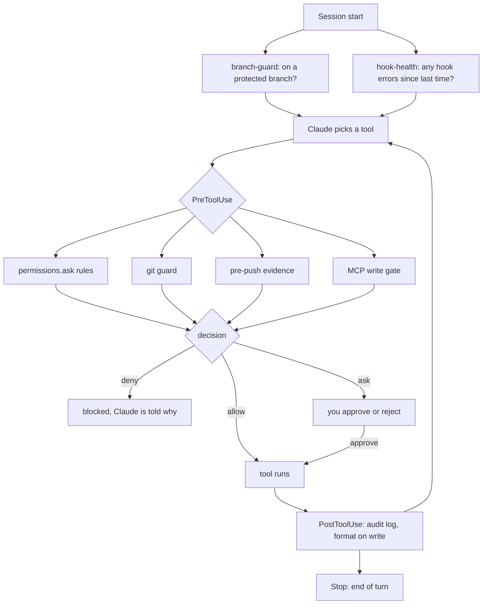

# claude-code-guardrails

Guardrail hooks for [Claude Code](https://docs.claude.com/en/docs/claude-code) that turn your team rules into checks the agent cannot skip. Written rules ("never commit to main", "run the tests before pushing", "never email a customer without asking") get forgotten in long sessions. Hooks do not.

Python 3.9+ standard library only. No dependencies. Works with any language: the test runner, formatter and test file naming are all configuration.

## What it does

| Guard | When | Result |
| --- | --- | --- |
| `block-dangerous-git.py` | before every Bash command | **deny** commits and pushes to protected branches, `--no-verify`, and destructive commands you list (prod DB wipes, `terraform destroy` on prod, `rm -rf /`) |
| `pre-push-evidence.py` | before `git push` | runs your formatter check and the tests matching the changed files. **deny** on failure, **ask** when there are no tests or the container is down |
| `gate-unreviewed-mcp-writes.py` | before every MCP tool call | **ask** for any write tool (send, create, update, delete...) on the servers you gate, unless you reviewed it and put it on the allowlist |
| `permissions.ask` rules | before the matching tool | **ask** every time for outward or irreversible actions (merge, deploy, send email, post to Slack) |
| `audit-mcp-actions.py` | after every MCP call | **log** every MCP write to `~/.claude/audit/YYYY-MM.jsonl` |
| `format-on-write.py` | after Edit or Write | formats the file with the formatter for its extension |
| `branch-guard.py` | session start | warns the agent if it starts on a protected branch |
| `hook-health.py` | session start | shows any hook failures since the last session |

## The lifecycle



Each check gives one of three answers:

- **allow**: the hook prints nothing and the call continues to the normal permission rules.
- **ask**: you see the exact call and approve or reject it.
- **deny**: the call is blocked and Claude gets the reason, so it can fix the problem (create a branch, fix the test) and try again.

### Failing closed

A guard that crashes must not quietly let things through. Every PreToolUse hook catches its own errors and turns them into **ask**, then writes one line to `~/.claude/audit/hook-errors.log`. At the next session start `hook-health.py` shows those lines to Claude, which tells you. A broken or unreadable config file is treated the same way: the MCP gate asks for every call until it is fixed.

## Install

```bash
git clone https://github.com/kevariable/claude-code-guardrails.git
cd claude-code-guardrails
python3 tests/run_tests.py
./install.sh --project ~/code/my-app
```

`install.sh` copies the hooks to `~/.claude-guardrails`, creates `guardrails.config.json` and `mcp-write-allowlist.txt` there from the examples (never overwriting existing ones), and merges the hooks and ask rules into `~/code/my-app/.claude/settings.json`. The merge only adds: your existing keys, hooks and rules stay, a timestamped backup is written first, and running it twice changes nothing.

| Flag | Effect |
| --- | --- |
| `--project DIR` | project to wire up (default: current directory) |
| `--user` | write to `~/.claude/settings.json` so every project gets the hooks |
| `--dest DIR` | install location (default `~/.claude-guardrails`) |
| `--link` | symlink `hooks/` to this clone so `git pull` updates them |
| `--no-settings` | copy files only |
| `--dry-run` | print the merged settings, write nothing |
| `--uninstall` | remove the hook entries again (ask rules and files are left for you to delete) |

Start a new Claude Code session afterwards so the hooks load.

## Configure

Everything lives in one file, `~/.claude-guardrails/guardrails.config.json`. Start from [`guardrails.config.example.json`](guardrails.config.example.json). Any key you leave out falls back to a built in default.

| Key | Meaning |
| --- | --- |
| `protected_branches` | branches nobody commits or pushes to directly |
| `audit_dir` | where the MCP log, push evidence and hook errors go |
| `allowlist_path` | the reviewed MCP write tools file |
| `destructive_commands` | list of `{pattern, context, reason}` regexes. Denied when `pattern` matches and `context` matches too (empty context means always) |
| `mcp.gated_server_prefixes` | MCP servers whose write tools need review, e.g. `mcp__your-crm__` |
| `mcp.write_verb_regex` | how a tool name is recognised as a write |
| `mcp.audit_all_servers` | log writes on every server, or only gated ones |
| `formatters` | per file extension: `root_marker` (file that marks the project root) and `command` (`{file}` and `{root}` are filled in) |
| `format_exclude_globs` | paths never formatted |
| `push_evidence` | `max_tests`, timeouts, and `docker_bin` |
| `repos` | one entry per repository the push check should test (below) |

Environment overrides: `GUARDRAILS_CONFIG` (config file path), `GUARDRAILS_AUDIT_DIR`, `GUARDRAILS_ALLOWLIST`.

### Add a repository

The push check only runs for repositories listed under `repos`. A repo that is not listed pushes unchecked (the git guard still applies everywhere).

```json
{
  "name": "my-python-service",
  "path": "~/code/my-python-service",
  "base_ref": "origin/main",
  "app_dir": ".",
  "changed_file_globs": ["src/**/*.py"],
  "exclude_globs": [".venv/**"],
  "tests_dir": "tests",
  "test_file_pattern": "test_{stem}.py",
  "formatter_check": "ruff format --check {files}",
  "test_runner": "pytest {files}"
}
```

- `base_ref`: what the branch is compared against to find changed files.
- `app_dir`: subfolder holding the app, for monorepos. Globs and test paths are relative to it.
- `test_file_pattern`: how a test file is named from the source file stem. `{stem}Test.php` (PHPUnit, Pest), `test_{stem}.py` (pytest), `{stem}.test.ts` (Jest, Vitest). Changed test files always run.
- `test_runner` and `formatter_check`: commands where `{files}` expands to the file list. Other placeholders: `{container}`, `{app_root}`, `{repo_root}`.
- Tests inside Docker: use `"test_runner": "docker exec {container} php artisan test {files}"` plus `"container": "my-app-1"`. When the container is down, or you push from a worktree the container does not mount, the hook asks instead of guessing.

A commit SHA that passed once is recorded in `push-evidence.jsonl` and not tested again.

### Review an MCP write tool

When the gate asks about a tool, decide once:

1. Read what the tool does. Does it send anything to a person outside the team (email, message, invite)? Does it spend money or credits? Can it be undone?
2. If it is internal and reversible (a note, a draft, a score), add it to `mcp-write-allowlist.txt` with the reason:
   ```
   mcp__your-crm__add_note  # internal note, reversible
   ```
3. If it sends, spends or cannot be undone, add it to `permissions.ask` in `settings.json` instead, so it always asks.

A tool must never be on both lists; the test suite checks this.

## Tests

```bash
python3 tests/run_tests.py
```

No Docker, network or MCP servers needed. The git guard cases live in [`tests/git-guard-cases.txt`](tests/git-guard-cases.txt) as `expected|repo|command`, so adding a case for a command that slipped through is one line. Run the suite after every hook change. CI runs it on Python 3.9 and 3.12.

## Version your harness (optional)

Your guardrails, settings and agent instructions change often, and product repos usually gitignore `.claude/`. [`tools/harness-vcs`](tools/harness-vcs) keeps them in bare git repos beside your projects:

```bash
cp tools/harness-vcs/harness-vcs.example.json ~/.claude-guardrails/harness-vcs.json
~/.claude-guardrails/tools/harness-vcs/harness init
~/.claude-guardrails/tools/harness-vcs/harness home add -f .claude/settings.json
~/.claude-guardrails/tools/harness-vcs/harness all log --oneline
```

To commit every change automatically, add `harness_autocommit.py` to your user settings on `PostToolUse` (matcher `Edit|Write|MultiEdit`) and on `Stop`. Roll back with `harness <key> checkout <sha> -- <path>`.

## Limits

- Commands are parsed, not executed. Quoted operators, `cd`, `git -C`, heredocs, `bash -c` and `eval` are handled. Command substitution (`$(...)`), aliases and scripts that run git internally are not looked into.
- The git guard is a seatbelt, not a lock. Keep branch protection on your Git host as well.
- The MCP gate recognises writes by verb in the tool name. A write tool with an unusual name passes as a read, so check new servers and extend `write_verb_regex` if needed.

## License

MIT
